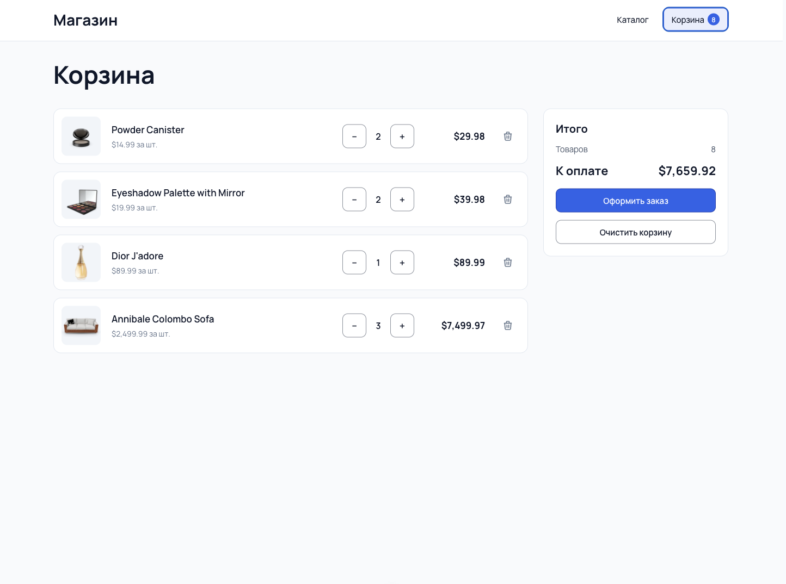

# Онлайн-магазин с корзиной

Мини-магазин с каталогом, корзиной и оформлением заказа

## Стек

Vue 3, TypeScript, Vue Router, Pinia, Vite

## Описание приложения

### Каталог (`/`)
Карточки товаров, есть фильтры по категориям. При загрузке лоадер, при ошибке блок с кнопкой Попробовать снова


### Страница товара (`/product/:id`)
Кроме данных из карточки, показывает описание товара и сколько штук уже лежит в корзине


### Корзина (`/cart`)
Можно менять количество товара, удалять позиции и очищать корзину целиком. Итоговые количество и сумма считаются автоматически



### Оформление заказа (`/checkout`)
Навигационный гард не пускает сюда с пустой корзиной, после оформления корзина очищается


## Как устроено

### Данные
- Товары загружаются из [DummyJSON](https://dummyjson.com/docs/products)
- Запросы вынесены в слой API
- Composable `useAsync` хранит данные, состояния загрузки и ошибки для любого запроса

### Состояние
- Стор `cart`:
  - состояние: `items` это массив `{ product, quantity }`
  - геттеры: `totalCount`, `totalPrice`
  - экшены: `addItem`, `decreaseItem`, `deleteItem`, `clear`

### Роутинг
- Страницы загружаются лениво
- Параметр `id` передается в страницу товара пропсом (`props: true`)
- У маршрутов есть `meta.section`, по нему шапка определяет, какой пункт меню подсветить
- Гард `beforeEnter` на `/checkout` перенаправляет в корзину, если она пуста

### Компоненты
- `ShopButton` поддерживает три варианта (`fill`, `outline`, `text`) и умеет быть и кнопкой, и ссылкой (`RouterLink`) через проп `to`.


## Структура

```
src/
├── api/          запросы к DummyJSON
├── components/   переиспользуемые компоненты
├── composables/  useAsync
├── constants/    общие константы
├── pages/        страницы (каталог, товар, корзина, оформление)
├── router/       маршруты и гард
├── stores/       Pinia стор корзины
├── types/        типы Card, Product, CartItem
└── utils/        formatPrice
```

## Запуск

```sh
npm i
npm run dev
```
